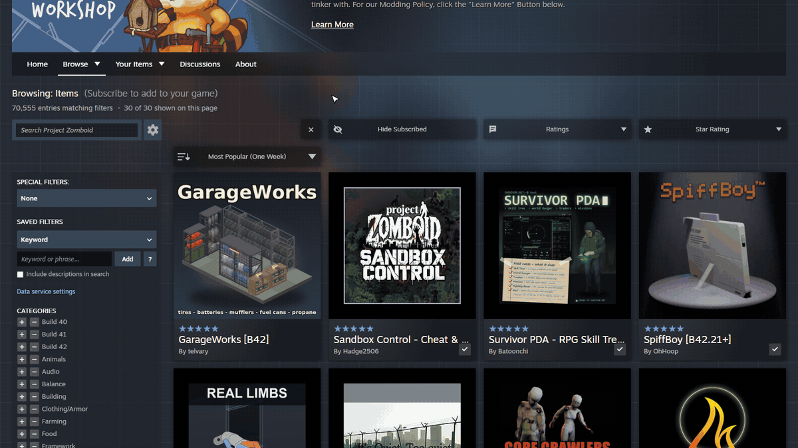
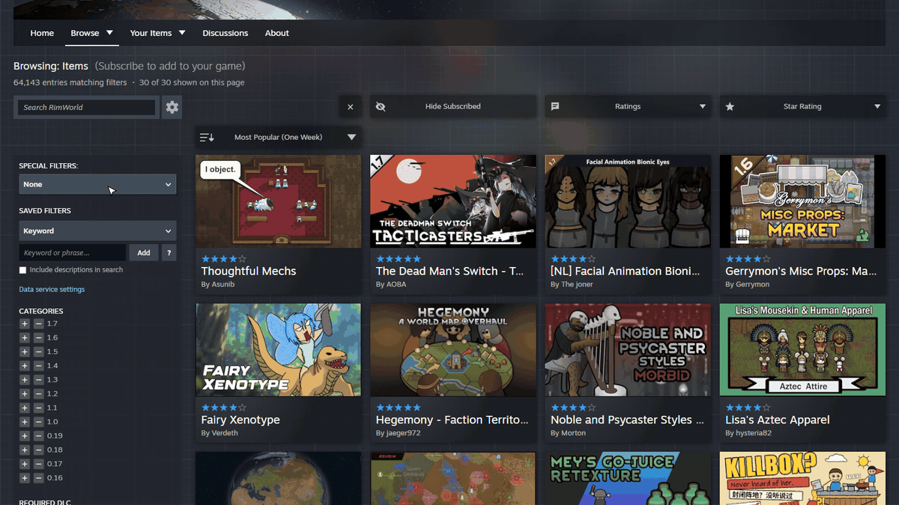
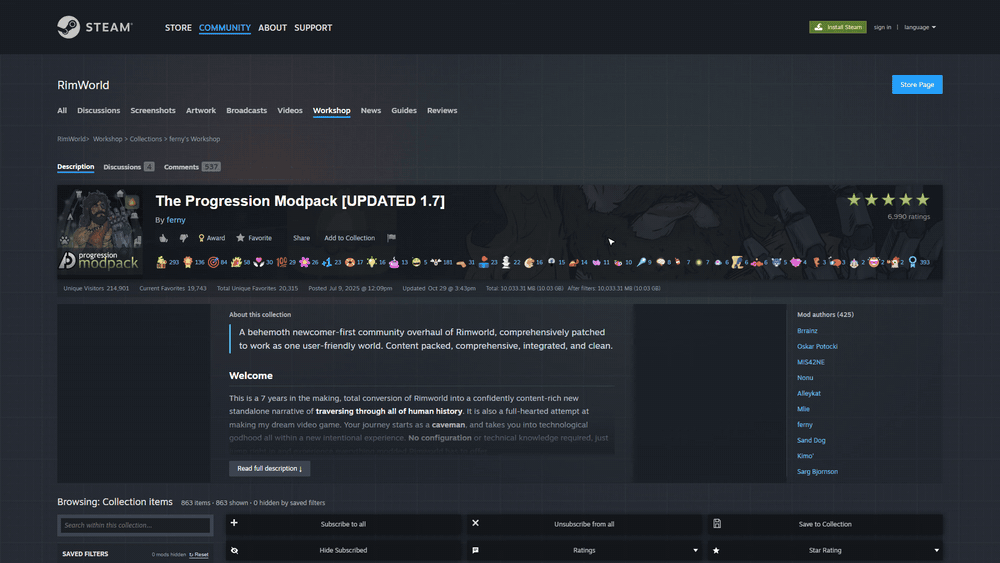
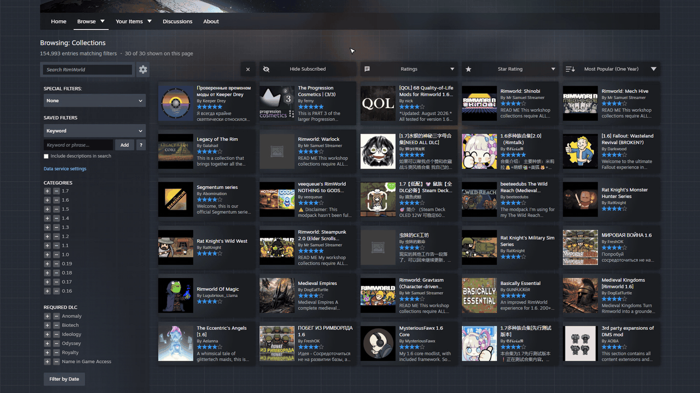
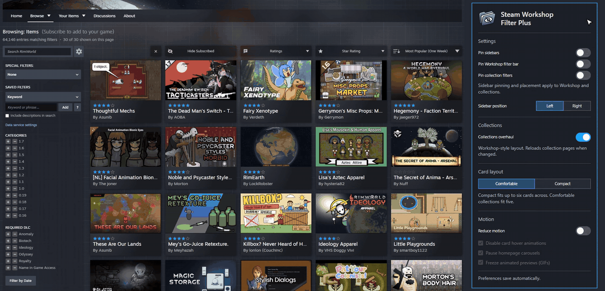

# Steam Workshop Filter Plus

A Chrome and Firefox extension that adds filters to Steam Workshop pages and collections. Hide the mods you already have, drop the ones with low or few ratings, and save keyword and creator filters for each game.

[Chrome Web Store](https://chromewebstore.google.com/detail/steam-workshop-filter-plu/ahdjppacldfaiahihkhfkhhmadhicfda) | [Firefox Add-ons](https://addons.mozilla.org/en-US/firefox/addon/steam-workshop-filter-plus/) | [Releases](https://github.com/dcave14/Steam-Workshop-Filter-Plus/releases) | [Full guide](docs/guide.md)

*Hide subscribed mods, require 100+ ratings and 5 stars, then sort. The filters stay on.*

*Save a keyword, or hide a creator straight from a mod card.*

*Collections get a Workshop-style layout, the same filters, and their size before and after filtering.*

*The filters work on the Collections browse page too.*

*The toolbar popup: Compact layout, sidebar on either side, pinned sidebar and filter bar.*

## Features

- **Hide Subscribed**, **Star Rating** and minimum **Ratings** filters
- **Saved filters** for keywords, creators and required mods, kept per game, with groups
- **Workshop-style collection pages** with sizes before and after filters
- **Subscribe to all** that skips mods your saved filters exclude
- **Compact layout**, left or right sidebar, pinning and reduced motion
- **75 or 100 mods per page**

## Install

- **Chrome, Edge, Brave:** [Chrome Web Store](https://chromewebstore.google.com/detail/steam-workshop-filter-plu/ahdjppacldfaiahihkhfkhhmadhicfda)
- **Firefox 140+** (and Firefox for Android 142+): [Firefox Add-ons](https://addons.mozilla.org/en-US/firefox/addon/steam-workshop-filter-plus/)
- **Manual:** unzip the latest `-chrome.zip` from [Releases](https://github.com/dcave14/Steam-Workshop-Filter-Plus/releases), open `chrome://extensions`, turn on Developer mode, then **Load unpacked**

## Usage

Open any Workshop or collection page. The filters sit next to Steam's sort menu, or under **Subscribe to all** on collections. Layout and pinning live in the toolbar popup, and everything saves automatically.

The [guide](docs/guide.md) covers every control in detail.

## Privacy

No tracking. Public item IDs go to Steam and the shared Workshop data service, never your login or subscriptions. See the [privacy policy](https://dcave14.github.io/Steam-Workshop-Filter-Plus/privacy-policy.html).

## Development

Plain JavaScript with no compile step. `node build.js` writes the Chrome and Firefox zips to `dist/`, and `node tests/release-regression.js` runs the regression suite. More in the [guide](docs/guide.md#development).

## License

MIT, see `LICENSE`. Release notes are in [CHANGELOG.md](CHANGELOG.md).
